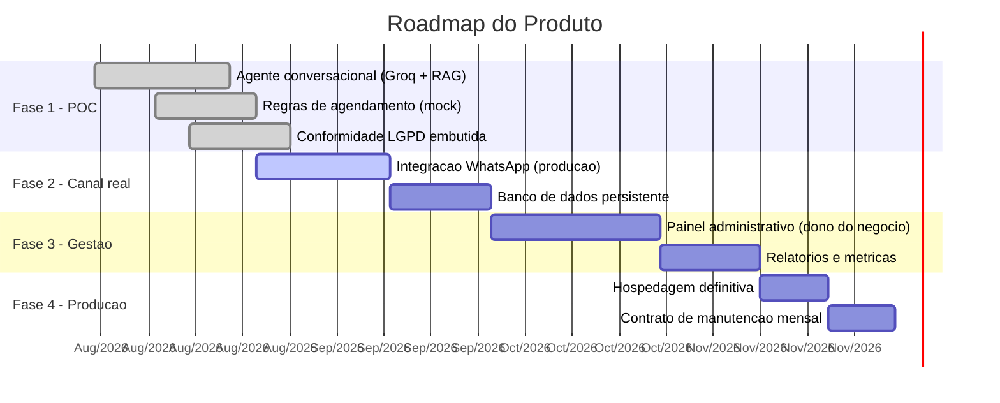
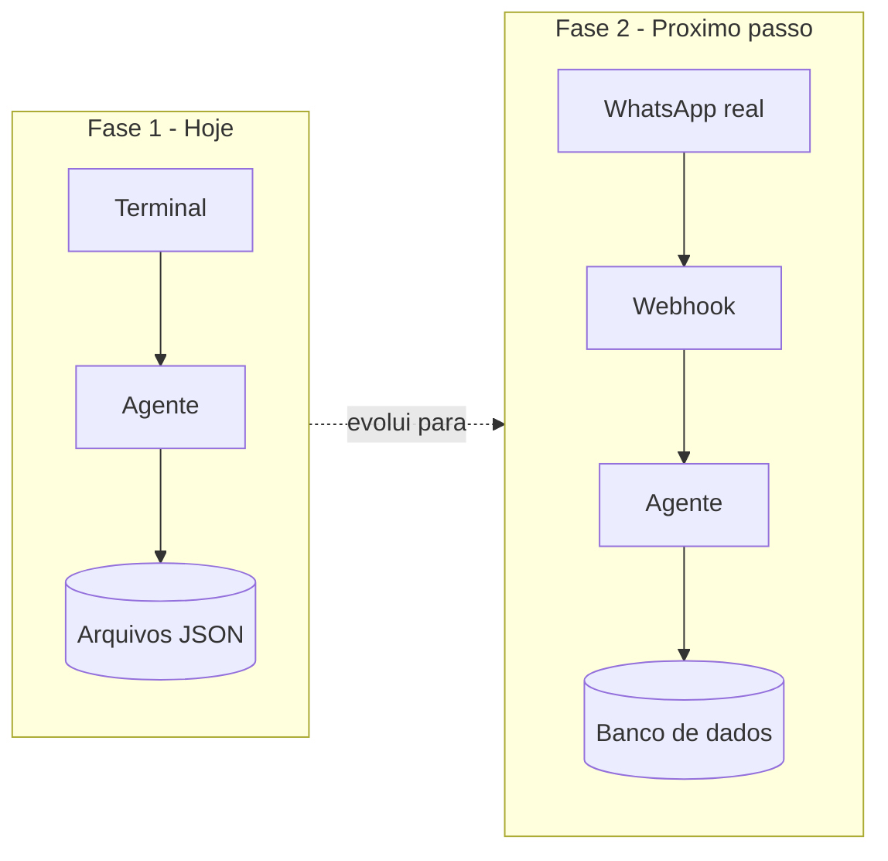
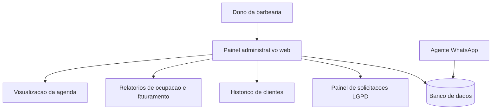

# Roadmap — Barbearia Corte Certo (Agente de Atendimento)

Este documento descreve a evolução planejada do produto, da POC atual até uma
oferta comercial completa para pequenos comércios (barbearias, salões,
clínicas de estética e negócios similares baseados em agendamento).

## Visão geral das fases

---

## Fase 1 — POC (concluída)

Objetivo: provar que a arquitetura funciona e demonstrar valor ao cliente.

- Agente conversacional orquestrado via Groq API (tool-calling)
- RAG leve (TF-IDF) para dúvidas sobre serviços, preços e horários
- Mock de endpoints REST para agendamento (criar, cancelar, remarcar)
- Módulo de conformidade LGPD: consentimento, direito de acesso, direito ao
  esquecimento, retenção de dados
- Demonstração via terminal (`interactive_cli.py`)

**Status:** funcional e testado localmente.

---

## Fase 2 — Canal de comunicação real

Objetivo: sair do terminal e do mock, indo para uma conversa real de WhatsApp
com dados persistentes.

### Estratégia de canal WhatsApp — decisão registrada

Depois de testar ambos os caminhos na prática, a estratégia adotada é em
**duas etapas**, não uma escolha única:

| Etapa | Provedor | Por quê |
|---|---|---|
| **Trial e primeiras semanas** | Z-API | Setup rápido (QR code), sem exigir CNPJ do cliente, ideal para validar o interesse antes de formalizar |
| **Após fechamento de contrato** | Meta Cloud API (produção) | Uma vez que o cliente registra um número de produção **brasileiro** (exige CNPJ/MEI), a comunicação passa a ser BR→BR e deixa de sofrer a restrição de mensagens entre países que a Meta aplica a números de teste americanos. Isso torna o canal gratuito até 1.000 conversas de serviço/mês, elimina o risco de banimento (canal oficial vs. não-oficial), e reforça o discurso comercial de conformidade/seriedade junto ao LGPD já implementado |

**Nota técnica importante**: a causa raiz de instabilidade observada durante
os testes com número de teste da Meta (erro 130497 — "Business account is
restricted from messaging users in this country") foi a política de
restrição de mensagens cross-border envolvendo o Brasil, aplicada a números
de teste americanos. Um número de produção brasileiro não é afetado por
essa restrição.

Migrar de Z-API para Meta oficial, quando chegar a hora, não exige reescrever
o agente — apenas trocar o arquivo de webhook em uso (`zapi_webhook.py` →
`whatsapp_webhook.py`), já que ambos reutilizam o mesmo `agent_orchestrator.py`.

- Trocar os arquivos JSON por um banco de dados real (PostgreSQL ou SQLite
  para começar), preservando o mesmo contrato de dados já usado no mock
- Formalizar retenção de dados e backups, alinhado ao módulo de LGPD já
  existente

---

## Fase 3 — Painel de gestão para o dono do negócio

Objetivo: dar visibilidade e controle para quem não mexe em código.

- Interface web simples (não precisa ser aplicativo de loja — acessível pelo
  navegador do celular)
- Visualização de agenda, histórico de clientes, taxa de ocupação
- Painel de solicitações LGPD (quem pediu acesso ou exclusão de dados, e
  quando foi atendido) — vira um argumento de venda de conformidade

---

## Fase 4 — Produção e modelo comercial

Objetivo: transformar o POC em produto vendável e sustentável.

- Hospedagem definitiva (Railway, Render ou similar) — elimina a
  dependência do ngrok e do computador local ligado
- Contrato de operador de dados (LGPD), formalizando a relação entre
  prestador de serviço (você) e controlador de dados (a barbearia)
- Modelo de cobrança sugerido: taxa de setup único + mensalidade de
  manutenção (cobre custo de hospedagem, WhatsApp Business API e suporte)

---

## Fora de escopo (por enquanto)

- Aplicativo nativo para Play Store/App Store — desnecessário enquanto o
  WhatsApp atender a necessidade do cliente final (ver decisão registrada
  na conversa de planejamento do produto)
- Pagamento integrado (Pix, cartão) — pode entrar como fase futura, se
  houver demanda validada dos clientes
